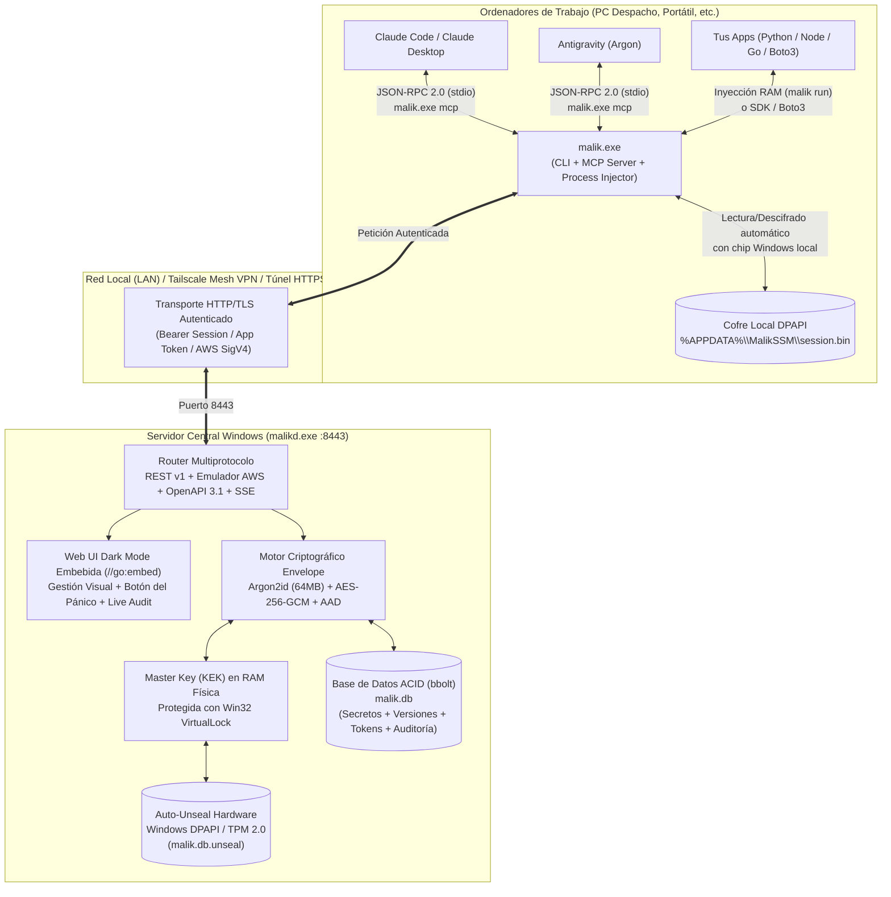
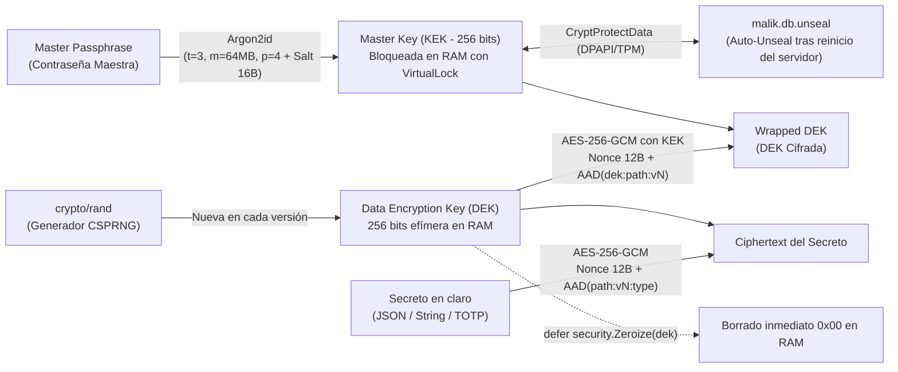

# 🛡️ MalikSSM — Agent-First Secrets & Session Manager

<p align="center">
  
  
  
  
</p>
<p align="center">
  
  
  
  
  
  
  
</p>

> **Infraestructura criptográfica de gestión de secretos y sesiones de grado industrial escrita en Go 1.26 nativo (`CGO_ENABLED=0`), diseñada para ejecutarse 24/7 en un servidor Windows / Homelab y eliminar por completo la fricción de credenciales entre humanos, agentes de IA (Claude, Antigravity, ChatGPT) y aplicaciones.**

---

## 📑 Índice de Contenidos

1. [Visión y Problema que Resuelve](#1-visión-y-problema-que-resuelve)
2. [Decisiones de Ingeniería: ¿Por qué Go Nativo y no Python?](#2-decisiones-de-ingeniería-por-qué-go-nativo-y-no-python)
3. [Arquitectura General del Sistema](#3-arquitectura-general-del-sistema)
4. [Seguridad Criptográfica y Protección de Memoria a Bajo Nivel](#4-seguridad-criptográfica-y-protección-de-memoria-a-bajo-nivel)
5. [Modelo de Autenticación Dual (Cero Tokens en Configs vs. App Tokens)](#5-modelo-de-autenticación-dual-cero-tokens-en-configs-vs-app-tokens)
6. [Modelo de Datos "Agent-First" y Buscador Semántico](#6-modelo-de-datos-agent-first-y-buscador-semántico)
7. [Los 4 Canales de Consumo Universal](#7-los-4-canales-de-consumo-universal)
   - [7.1 Servidor MCP Nativo (`malik.exe mcp`)](#71-canal-1-servidor-mcp-nativo-malikexe-mcp)
   - [7.2 CLI Universal e Inyector de Procesos (`malik.exe`)](#72-canal-2-cli-universal-e-inyector-de-procesos-malikexe)
   - [7.3 SDK Python y Emulador Nativo de AWS Secrets Manager (`boto3`)](#73-canal-3-sdk-python-y-emulador-nativo-de-aws-secrets-manager-boto3)
   - [7.4 Panel Web Dark Mode (`/ui`), API REST v1 y OpenAPI 3.1 (ChatGPT)](#74-canal-4-panel-web-dark-mode-ui-api-rest-v1-y-openapi-31-chatgpt)
8. [Estructura Completa del Proyecto](#8-estructura-completa-del-proyecto)
9. [Guía de Despliegue en Servidor Windows y Ordenadores de Trabajo](#9-guía-de-despliegue-en-servidor-windows-y-ordenadores-de-trabajo)
10. [Referencia Completa de la API HTTP](#10-referencia-completa-de-la-api-http)
11. [Pruebas y Verificación de Calidad](#11-pruebas-y-verificación-de-calidad)

---

## 1. Visión y Problema que Resuelve

En un flujo de trabajo moderno con múltiples agentes de IA (**Claude Code**, **Claude Desktop**, **Antigravity**, **ChatGPT**) repartidos en varios ordenadores y servidores locales, las contraseñas, claves SSH, semillas 2FA y API keys suelen convertirse en un cuello de botella constante:

* Los agentes preguntan continuamente *"¿Cuál es la IP del servidor?"*, *"¿Dónde está el archivo `.env`?"* o *"Pásame la API key"*.
* Pegar contraseñas en el chat contamina el contexto enviado a la nube y deja secretos expuestos en historiales.
* Esparcir archivos `.env` por decenas de carpetas en distintos ordenadores provoca desincronización cuando se rota una clave.

**MalikSSM** traslada la experiencia exacta de **AWS Secrets Manager + AWS SSO** a tu propio **Servidor Windows / Homelab**:
1. **Un único punto de verdad (`malikd.exe`)** corriendo 24/7 en tu servidor central con consumo mínimo (~12 MB de RAM).
2. **Autenticación matutina (`malik login`)**: te autenticas una vez al encender tu PC (o cada 30 días en equipos de confianza) y **todos tus agentes y programas en ese ordenador heredan automáticamente el acceso** sin que tengas que pegar ni un solo token en archivos de configuración.
3. **Descubrimiento semántico sin exposición**: los agentes pueden buscar qué secretos existen y qué campos contienen (`schema_keys`) antes de pedir su valor o inyectarlos a ciegas en un proceso.

---

## 2. Decisiones de Ingeniería: ¿Por qué Go Nativo y no Python?

Para construir un gestor de secretos verdaderamente seguro, se descartó Python en favor de **Go 1.26 compilado estáticamente (`CGO_ENABLED=0`)** por cuatro razones técnicas fundamentales:

| Vector de Seguridad / Operativa | Problema en Python | Solución Implementada en MalikSSM (Go 1.26) |
| :--- | :--- | :--- |
| **Persistencia de secretos en RAM** | Los tipos `str` y `bytes` en Python son **inmutables**. Al desencriptar una clave se crean copias en el *heap* que no pueden sobrescribirse con ceros hasta que el *Garbage Collector* las recicle. | Los buffers criptográficos (`[]byte`) son **mutables**. La función [`security.Zeroize`](internal/security/memguard.go) sobrescribe cada byte con `0x00` inmediatamente después de cada cifrado/descifrado usando `runtime.KeepAlive` para impedir que el optimizador elimine el borrado. |
| **Fuga de claves al disco (`pagefile.sys`)** | Python no bloquea páginas de memoria física de forma nativa; Windows puede volcar la clave maestra al archivo de paginación del SSD. | [`security.LockedKey`](internal/security/memguard.go) invoca directamente la syscall Win32 **`VirtualLock`** (`kernel32.dll`), obligando al kernel de Windows a mantener la Master Key exclusivamente en RAM física. |
| **Modificación en tiempo de ejecución (*Monkey-Patching*)** | En Python cualquier dependencia puede inspeccionar `gc.get_objects()` o redefinir funciones de validación en caliente. | Binario compilado estáticamente a código máquina nativo (`x86_64`) con tablas de tipos y funciones inmutables. |
| **Integración con Hardware TPM / DPAPI** | Requiere librerías externas (`pywin32`) y entornos virtuales frágiles. | Syscalls directas a **`CryptProtectData`** y **`CryptUnprotectData`** (`crypt32.dll`) integradas en [`memguard_windows.go`](internal/security/memguard_windows.go). |
| **Distribución Multi-Ordenador** | Obliga a instalar Python + `venv` + `pip` en el servidor y en cada PC. | Solo existen **2 ejecutables puros** (`malikd.exe` de 7.0 MB y `malik.exe` de 6.3 MB) con cero dependencias externas. |

---

## 3. Arquitectura General del Sistema



---

## 4. Seguridad Criptográfica y Protección de Memoria a Bajo Nivel

### 4.1 Cifrado por Sobres (*Envelope Encryption*)
Al igual que AWS KMS + AWS Secrets Manager, MalikSSM **nunca cifra todos los secretos directamente con la misma clave**:



1. **Derivación de la Clave Maestra (`KEK`)**:
   * Se deriva a partir de tu contraseña maestra mediante **Argon2id** (`Time=3`, `Memory=64 MB`, `Threads=4`, `KeyLen=32 bytes`).
   * Se valida contra un bloque canario autenticado (`MalikSSM::AuthenticatedCanary::v1`) antes de instalarse en memoria.
2. **Claves de Datos Efímeras (`DEK`) por Secreto y Versión**:
   * Cada vez que creas o rotas un secreto (`v1` → `v2`), se genera una clave aleatoria fresca de 256 bits (`DEK`) con `crypto/rand`.
   * El contenido del secreto se cifra con esa `DEK` mediante **AES-256-GCM**.
   * La propia `DEK` se cifra con la `KEK` y **se destruye inmediatamente de la memoria RAM (`Zeroize(dek)`)**.
3. **Protección Anti-Manipulación con Datos Autenticados Adicionales (`AAD`)**:
   * Al cifrar el secreto se vincula criptográficamente la cadena `payload:<ruta>:v<versión>:<tipo>` como AAD del bloque GCM, y al cifrar la DEK se vincula `dek:<ruta>:v<versión>`.
   * Si alguien manipulara el archivo `malik.db` intentando mover el bloque cifrado de un secreto a otro o suplantar una versión, la verificación matemática de la etiqueta GCM falla en el acto (`ErrTamperedEnvelope`).

### 4.2 Auto-Unseal en el Servidor Windows y Botón del Pánico (`Lock`)
* **Auto-Unseal silencioso tras reinicios**:
  Cuando activas Auto-Unseal en el servidor, los 32 bytes de la `KEK` se sellan a través del chip de seguridad del sistema mediante la API Win32 `CryptProtectData` con entropía de dominio. Si el servidor se reinicia de madrugada tras una actualización de Windows, `malikd.exe` arranca, desencripta el sobre con el TPM/DPAPI de la máquina y carga la `KEK` en memoria `VirtualLock` sin intervención manual.
* **Botón del Pánico (`malik lock` o botón rojo en la Web UI)**:
  Ejecuta `LockedKey.Destroy()` (sobrescribe los 32 bytes de la `KEK` en RAM con ceros, libera el `VirtualUnlock`) y revoca instantáneamente todas las sesiones activas en la base de datos.

---

## 5. Modelo de Autenticación Dual (Cero Tokens en Configs vs. App Tokens)

MalikSSM distingue dos escenarios reales para que la seguridad nunca esté reñida con la comodidad:

### Escenario A: Tus Ordenadores de Trabajo (Sesiones `mlk_sess_...` selladas con DPAPI)
* **Objetivo**: Que ni Claude, ni Antigravity, ni tu terminal te pidan tokens ni tengas que editar archivos JSON de configuración cuando caduquen.
* **Funcionamiento**:
  1. Ejecutas `malik login --server http://ip-servidor:8443` (puedes añadir `--days 30` en tu PC fijo para hacerlo solo una vez al mes).
  2. El servidor devuelve un token de sesión `mlk_sess_...`.
  3. `malik.exe` cifra ese token con el **Windows DPAPI de tu usuario en ese PC** y lo guarda en `%APPDATA%\MalikSSM\session.bin`.
  4. Cuando Claude o Antigravity invocan `malik.exe mcp`, o cuando ejecutas `malik get` / `malik run`, el binario lee y desencripta `%APPDATA%\MalikSSM\session.bin` en memoria automáticamente.
  5. Además, `malik.exe mcp` recarga el archivo `session.bin` en cada llamada a herramienta: si abres Claude primero y haces `malik login` después, **no necesitas reiniciar Claude**.

### Escenario B: Bots 24/7, Contenedores y ChatGPT en la Nube (`App Tokens` `mlk_live_...`)
* **Objetivo**: Dar acceso desatendido a aplicaciones concretas o a un Custom GPT de OpenAI, pero **restringiendo estrictamente qué carpetas pueden leer**.
* **Funcionamiento**:
  1. Creas un token con `malik token create --name "bot-facturacion" --allow "facturacion/*,apis/stripe" --perms "read,search,totp"`.
  2. El servidor almacena únicamente el hash **SHA-256** del token y sus reglas de acceso (*Scopes* Glob + *Permissions*).
  3. Si ese token intenta leer `servidores/hetzner/ssh`, el motor [`vault.CheckAccess`](internal/vault/store.go) bloquea la petición con `403 Forbidden` y registra una alerta `DENIED` en el log de auditoría.

---

## 6. Modelo de Datos "Agent-First" y Buscador Semántico

Cada secreto en MalikSSM separa **Metadatos de Descubrimiento** (visibles en búsquedas) del **Payload Cifrado** (solo desencriptado bajo petición):

```json
{
  "path": "servidores/nodo-central/ssh",
  "arn": "arn:aws:secretsmanager:local:000000000000:secret:servidores/nodo-central/ssh",
  "type": "kv",
  "description": "SSH principal del servidor central",
  "tags": ["local", "infra", "ssh"],
  "schema_keys": ["host", "password", "port", "totp", "username"],
  "current_version": 2,
  "previous_version": 1,
  "version_count": 2
}
```

### ¿Por qué `schema_keys` es clave para los agentes de IA?
Cuando Claude o Antigravity buscan `"ssh servidor"`, reciben inmediatamente `schema_keys: ["host", "password", "port", "totp", "username"]`. Así el agente **sabe con certeza matemática cómo se llaman los campos internos del secreto** sin tener que adivinar si el usuario lo llamó `user`, `username` o `login`.

### Algoritmo de Puntuación Semántica (`SearchSecrets`)
El motor de búsqueda tokeniza la consulta del agente (separando espacios, barras, guiones y puntos) y asigna pesos acumulativos:
* **+100 puntos**: Coincidencia exacta con la ruta (`path`).
* **+50 puntos**: La ruta contiene la consulta completa como subcadena.
* **+35 puntos**: Coincidencia exacta de token con una etiqueta (`tag`).
* **+25 puntos**: Coincidencia de token con un segmento de la ruta (`path`).
* **+20 puntos**: Coincidencia parcial en etiqueta (`tag`).
* **+15 puntos**: Coincidencia de token en la descripción (`description`).
* **+10 puntos**: Coincidencia de token con el nombre de un campo interno (`schema_keys`).

---

## 7. Los 4 Canales de Consumo Universal

### 7.1 Canal 1: Servidor MCP Nativo (`malik.exe mcp`)
Integrado dentro de `malik.exe` siguiendo el estándar JSON-RPC 2.0 sobre `stdio`. Expone **6 herramientas nativas** para Claude Desktop, Claude Code y Antigravity:

| Herramienta MCP | Argumentos Principales | Qué hace |
| :--- | :--- | :--- |
| **`secrets_search`** | `query` (string), `tags` (string[]) | Busca secretos semánticamente y devuelve rutas, descripciones, tags y `schema_keys` sin revelar contraseñas. |
| **`secrets_get`** | `path` (string), `field` (opc.), `stage` (opc.) | Desencripta y devuelve el secreto completo o un campo específico (`AWSCURRENT` o `AWSPREVIOUS`). |
| **`secrets_set`** | `path`, `type`, `description`, `tags`, `data`, `value` | Crea un secreto nuevo o rota uno existente incrementando su versión automáticamente. |
| **`secrets_totp`** | `path` (string) | Calcula en tiempo real el código 2FA TOTP de 6 dígitos (RFC 6238) y los segundos restantes de validez. |
| **`secrets_exec`** | `secrets` (string[]), `command` (string / string[]) | **Inyección a ciegas**: ejecuta un comando local inyectando los secretos en RAM y censurando (`***REDACTED***`) cualquier contraseña en la salida. |
| **`vault_status`** | *(ninguno)* | Devuelve el estado de salud, bloqueo, número de secretos y sesiones del servidor. |

### 7.2 Canal 2: CLI Universal e Inyector de Procesos (`malik.exe`)
Equivalente directo a `aws secretsmanager` con superpoderes añadidos:

```powershell
# 1. Iniciar sesión en tu ordenador (se guarda cifrada en Windows DPAPI local)
malik login --server http://192.168.1.50:8443 --days 30

# 2. Crear o actualizar secretos (soporta pares clave=valor o --value plano)
malik set apis/openai/prod api_key=sk-proj-12345 org_id=org-99 --desc "API Key OpenAI" --tags "ia,openai"

# 3. Buscar secretos por lenguaje natural
malik search "openai ia"

# 4. Leer un secreto completo en JSON o extraer un campo concreto en crudo (--raw)
malik get apis/openai/prod
malik get apis/openai/prod --field api_key --raw

# 5. Recuperar la versión anterior si rotaste una contraseña por error
malik get apis/openai/prod --stage AWSPREVIOUS

# 6. Generar código 2FA de 6 dígitos
malik totp servidores/nodo-central/ssh

# 7. Inyectar secretos en memoria RAM en cualquier programa sin archivos .env
malik run -s apis/openai/prod -s db/postgres -- python mi_bot.py

# 8. Usar placeholders en línea dentro de comandos (se censuran en stdout/stderr)
malik run -- curl -H "Authorization: Bearer {{SECRET:apis/openai/prod#api_key}}" https://api.openai.com/v1/models
```

> **Censura Inteligente en `malik run` y `secrets_exec`**:
> El inyector ([`internal/injector/runner.go`](internal/injector/runner.go)) distingue entre metadatos de conexión (`host`, `port`, `username`, `database`, `region`) y valores sensibles (`password`, `api_key`, `token`, `secret`, `totp`). Si el subproceso imprime su configuración por consola, la IP y el usuario permanecen legibles para depurar, pero las contraseñas se reemplazan en tiempo real por `***REDACTED***`.

### 7.3 Canal 3: SDK Python y Emulador Nativo de AWS Secrets Manager (`boto3`)

#### A. Usando el SDK nativo sin dependencias ([`sdk/python/malik.py`](sdk/python/malik.py)):
```python
from sdk.python.malik import MalikClient

# No necesita token si ya hiciste 'malik login' en tu PC (o lee MALIK_TOKEN en servidores)
vault = MalikClient(server_url="http://192.168.1.50:8443")

# Buscar secretos
resultados = vault.search("ssh")

# Obtener diccionario completo o un campo concreto
ssh_creds = vault.get("servidores/nodo-central/ssh")
password  = vault.get("servidores/nodo-central/ssh", field="password")

# Obtener código 2FA TOTP de 6 dígitos
codigo_2fa = vault.totp("servidores/nodo-central/ssh")
```

#### B. Usando el SDK oficial de AWS (`boto3`) sin cambiar tu código existente:
`malikd.exe` implementa el protocolo exacto `application/x-amz-json-1.1` de AWS Secrets Manager (`GetSecretValue`, `ListSecrets`, `CreateSecret`, `PutSecretValue`, `DescribeSecret`, `DeleteSecret`):
```python
import boto3

sm = boto3.client(
    "secretsmanager",
    endpoint_url="http://192.168.1.50:8443",
    aws_access_key_id="mlk_live_TU_TOKEN_O_SESION",
    aws_secret_access_key="malik",
    region_name="local",
)

resp = sm.get_secret_value(SecretId="apis/openai/prod")
print(resp["SecretString"])
```

### 7.4 Canal 4: Panel Web Dark Mode (`/ui`), API REST v1 y OpenAPI 3.1 (ChatGPT)
* **Panel Web (`/ui`)**: Incrustado en `malikd.exe`. Permite crear, editar y rotar secretos, visualizar y copiar campos, ver códigos 2FA TOTP con cuenta atrás en vivo, generar `App Tokens`, monitorizar en tiempo real las consultas de los agentes mediante Server-Sent Events (SSE) y activar el **Botón del Pánico**.
* **ChatGPT Custom GPT Actions (`/openapi.json`)**: Sirve dinámicamente el esquema OpenAPI 3.1.0 listo para importar en un GPT privado de ChatGPT junto con un `App Token` acotado.

---

## 8. Estructura Completa del Proyecto

```text
MalikSSM/
├── bin/
│   ├── malikd.exe                  # Servidor nativo Windows (x64)
│   ├── malikd-linux-amd64          # Servidor nativo Linux (x64)
│   ├── malik.exe                   # Cliente Todo-en-Uno Windows (x64)
│   ├── malik-darwin-arm64          # Cliente Todo-en-Uno macOS Apple Silicon (M1/M2/M3/M4)
│   ├── malik-darwin-amd64          # Cliente Todo-en-Uno macOS Intel (x64)
│   ├── malik-linux-amd64           # Cliente Todo-en-Uno Linux (x64)
│   └── malik-linux-arm64           # Cliente Todo-en-Uno Linux (ARM64)
├── cmd/
│   ├── malikd/main.go              # Punto de entrada del servidor (flags, señales OS, arranque)
│   └── malik/main.go               # Punto de entrada del CLI, MCP y auto-configurador de agentes
├── internal/
│   ├── security/
│   │   ├── memguard.go             # Zeroize de memoria y estructura LockedKey
│   │   ├── memguard_windows.go     # Syscalls Win32: VirtualLock/VirtualUnlock y DPAPI CryptProtectData
│   │   ├── memguard_other.go       # Fallback multiplataforma para compilación en Linux/macOS
│   │   ├── envelope.go             # Envelope Encryption: Argon2id + DEK efímera + AES-256-GCM con AAD
│   │   └── envelope_test.go        # Tests unitarios de criptografía, DPAPI y detección de tampering
│   ├── totp/
│   │   ├── totp.go                 # Generador RFC 6238 TOTP (SHA1/256/512, Base32 y URIs otpauth://)
│   │   └── totp_test.go            # Verificación contra vectores oficiales RFC 6238
│   ├── vault/
│   │   ├── models.go               # Estructuras de datos, versiones, tokens, sesiones y auditoría
│   │   ├── store.go                # Motor ACID bbolt, Auto-Unseal, Scopes Glob y búsqueda semántica
│   │   └── store_test.go           # Tests de ciclo de vida, rotación v1/v2, scopes y reinicio Auto-Unseal
│   ├── server/
│   │   ├── server.go               # Multiplexor HTTP, CORS, middleware de autenticación multi-cabecera
│   │   ├── handlers_rest.go        # Endpoints REST v1 y stream SSE de auditoría en tiempo real
│   │   ├── handlers_aws.go         # Emulador nativo del protocolo AWS Secrets Manager (JSON 1.1)
│   │   ├── openapi.go              # Generador dinámico de esquema OpenAPI 3.1.0 para ChatGPT
│   │   ├── ui.go                   # Directiva //go:embed del panel web
│   │   ├── ui/index.html           # Aplicación Web Single-Page Dark Mode sin dependencias externas
│   │   └── server_test.go          # Tests de integración E2E de API REST, login DPAPI y protocolo AWS
│   ├── client/
│   │   ├── config.go               # Gestión de %APPDATA%\MalikSSM\session.bin cifrado con DPAPI
│   │   └── api_client.go           # Cliente HTTP tipado con atribución de agente (X-Malik-Agent)
│   ├── injector/
│   │   └── runner.go               # Inyección de secretos en subprocesos y censura en vivo (***REDACTED***)
│   └── mcp/
│       ├── server.go               # Servidor Model Context Protocol (JSON-RPC 2.0 sobre stdio)
│       └── tools.go                # Definición de esquemas JSON de las 6 herramientas MCP
├── sdk/
│   └── python/malik.py             # SDK Python sin dependencias + adaptador automático boto3
├── scripts/
│   ├── build-all.ps1               # Compilación cruzada estática para Windows, macOS y Linux
│   ├── install-server.ps1          # Instalador de servicio de arranque y firewall para Servidor Windows
│   ├── init-agents.ps1             # Configurador automático de PATH, MCP y reglas globales en Windows
│   └── init-agents.sh              # Configurador automático de PATH, MCP y reglas globales en macOS y Linux
├── go.mod
└── README.md
```

---

## 9. Guía de Despliegue en Servidor Windows y Ordenadores de Trabajo (Windows, macOS y Linux)

### Paso 1: Despliegue en el Servidor Central (Nodo 24/7)
1. Clona el repositorio o copia `bin\malikd.exe`, `bin\malik.exe` y `scripts\install-server.ps1` a tu servidor Windows (o usa `bin/malikd-linux-amd64` si lo despliegas en Linux).
2. Abre PowerShell como Administrador en el servidor y ejecuta:
   ```powershell
   .\scripts\install-server.ps1 -Port 8443
   ```
   *Esto copia los binarios a `C:\MalikSSM`, abre el puerto TCP `8443` en la red privada/Tailscale y registra la tarea `MalikSSM-Server-Daemon` para que arranque automáticamente al iniciar Windows.*
3. Abre `http://127.0.0.1:8443/ui` en el navegador del servidor (o desde tu PC usando la IP local/Tailscale del servidor) e introduce tu **Contraseña Maestra** dejando marcada la casilla **Auto-Unseal con Hardware Windows DPAPI / TPM**.

### Paso 2A: Configuración de Cliente en Ordenadores Windows
1. Ejecuta en PowerShell:
   ```powershell
   .\scripts\init-agents.ps1
   ```
2. Inicia sesión contra el servidor:
   ```powershell
   malik login --server http://IP-DEL-SERVIDOR:8443 --days 30
   ```

### Paso 2B: Configuración de Cliente en Ordenadores macOS (Apple Silicon / Intel) y Linux (x64 / ARM64)
1. Ejecuta el instalador Unix (detecta automáticamente `darwin/arm64`, `darwin/amd64`, `linux/amd64` o `linux/arm64`, instala `malik` en tu `PATH` y configura Claude Desktop + reglas globales):
   ```bash
   chmod +x ./scripts/init-agents.sh
   ./scripts/init-agents.sh
   ```
2. Inicia sesión contra el servidor (se sella localmente con `unix.Mlock` + identidad del equipo):
   ```bash
   malik login --server http://IP-DEL-SERVIDOR:8443 --days 30
   ```

---

## 10. Referencia Completa de la API HTTP

| Método y Ruta | Autenticación | Descripción |
| :--- | :--- | :--- |
| `GET /ui` | Pública (Login en UI) | Panel de control visual Dark Mode embebido. |
| `GET /openapi.json` | Pública | Esquema OpenAPI 3.1.0 para importar en ChatGPT Actions. |
| `GET /v1/system/status` | Pública | Estado de inicialización, bloqueo en RAM, Auto-Unseal y contadores. |
| `POST /v1/system/init` | Pública (1ª vez) | Inicializa la bóveda con la Master Passphrase y crea el sobre DPAPI. |
| `POST /v1/system/unlock` | Passphrase | Desbloquea manualmente la bóveda cargando la KEK en `VirtualLock`. |
| `POST /v1/system/lock` | Admin Session | **Botón del Pánico**: destruye la KEK en RAM y revoca sesiones activas. |
| `POST /v1/auth/login` | Passphrase | Emite un token de sesión `mlk_sess_...` (y auto-inicializa si es nueva). |
| `GET /v1/secrets` | Session / AppToken | Lista los metadatos de todos los secretos permitidos para el llamador. |
| `POST /v1/secrets` | Session / AppToken | Crea un secreto nuevo o genera una nueva versión cifrada (`vN+1`). |
| `GET /v1/search?q=...` | Session / AppToken | Búsqueda semántica puntuada por ruta, tags, descripción y `schema_keys`. |
| `GET /v1/secrets/{path}` | Session / AppToken | Desencripta y devuelve un secreto (soporta `?field=`, `?version=`, `?stage=`). |
| `DELETE /v1/secrets/{path}` | Session / AppToken | Elimina un secreto y su historial de versiones. |
| `GET /v1/totp/{path}` | Session / AppToken | Genera el código 2FA TOTP de 6 dígitos actual para ese secreto. |
| `GET /v1/tokens` | Admin Session | Lista los App Tokens (`mlk_live_...`) configurados. |
| `POST /v1/tokens` | Admin Session | Crea un nuevo App Token con `allowed_scopes` y `permissions`. |
| `DELETE /v1/tokens/{id}` | Admin Session | Revoca inmediatamente un App Token por su ID. |
| `GET /v1/audit` | Admin Session | Devuelve los últimos eventos del registro inmutable de auditoría. |
| `GET /v1/audit/stream` | Admin Session | Stream Server-Sent Events (SSE) de auditoría en tiempo real. |
| `POST /` (`X-Amz-Target`) | Session / AppToken | Emulador nativo del protocolo AWS Secrets Manager (`GetSecretValue`, etc.). |

---

## 11. Pruebas y Verificación de Calidad

Para ejecutar toda la batería de pruebas criptográficas, de hardware DPAPI, de almacenamiento transaccional, de rotación de versiones, de scopes y de emulación AWS:

```powershell
go test -buildvcs=false -v ./...
```

Para recompilar ambos ejecutables optimizados y sin símbolos de depuración (`-ldflags="-s -w"`):

```powershell
go build -buildvcs=false -ldflags="-s -w" -o bin\malikd.exe .\cmd\malikd
go build -buildvcs=false -ldflags="-s -w" -o bin\malik.exe  .\cmd\malik
```
