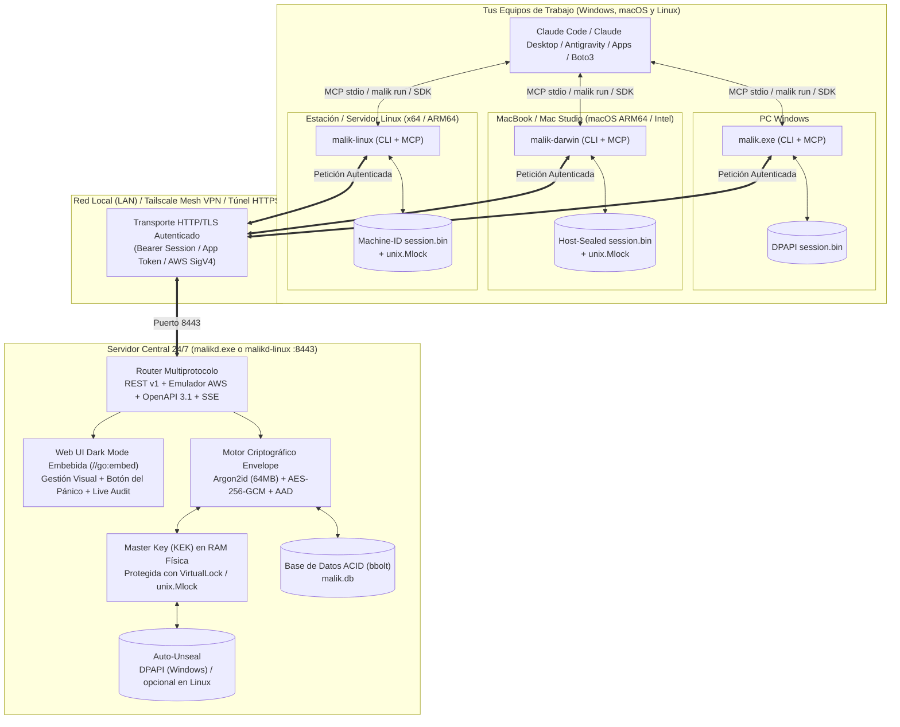
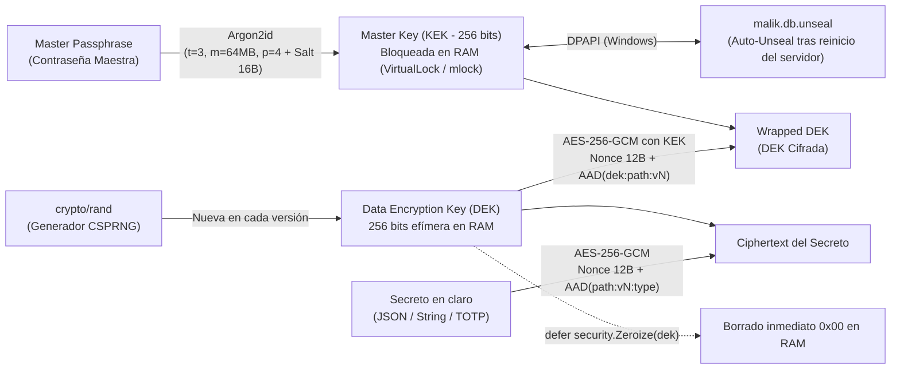

# 🛡️ MalikSSM — Multi-Platform Agent-First Secrets & Session Manager

<p align="center">
  
  
  
  
</p>
<p align="center">
  
  
  
  
  
  
  
</p>

> **Gestor de secretos y sesiones multiplataforma escrito en Go 1.26 nativo (`CGO_ENABLED=0`). Incluye servidor central (`Windows` y `Linux`) y clientes nativos todo-en-uno para `Windows`, `macOS (Apple Silicon & Intel)` y `Linux (x64 & ARM64)`, eliminando por completo la fricción de credenciales entre humanos, agentes de IA (Claude, Antigravity, ChatGPT) y aplicaciones.**

---

## 📑 Índice de Contenidos

1. [Visión y Problema que Resuelve](#1-visión-y-problema-que-resuelve)
2. [Soporte Multiplataforma Nativo (Windows, macOS y Linux)](#2-soporte-multiplataforma-nativo-windows-macos-y-linux)
3. [Decisiones de Ingeniería: ¿Por qué Go Nativo y no Python?](#3-decisiones-de-ingeniería-por-qué-go-nativo-y-no-python)
4. [Arquitectura General del Sistema](#4-arquitectura-general-del-sistema)
5. [Seguridad Criptográfica y Protección de Memoria a Bajo Nivel](#5-seguridad-criptográfica-y-protección-de-memoria-a-bajo-nivel)
6. [Modelo de Autenticación Dual (Cero Tokens en Configs vs. App Tokens)](#6-modelo-de-autenticación-dual-cero-tokens-en-configs-vs-app-tokens)
7. [Modelo de Datos "Agent-First" y Buscador Semántico](#7-modelo-de-datos-agent-first-y-buscador-semántico)
8. [Los 4 Canales de Consumo Universal](#8-los-4-canales-de-consumo-universal)
   - [8.1 Servidor MCP Nativo (`malik mcp`)](#81-canal-1-servidor-mcp-nativo-malik-mcp)
   - [8.2 CLI Universal e Inyector de Procesos (`malik`)](#82-canal-2-cli-universal-e-inyector-de-procesos-malik)
   - [8.3 SDK Python Multiplataforma y Emulador Nativo de AWS Secrets Manager (`boto3`)](#83-canal-3-sdk-python-multiplataforma-y-emulador-nativo-de-aws-secrets-manager-boto3)
   - [8.4 Panel Web Dark Mode (`/ui`), API REST v1 y OpenAPI 3.1 (ChatGPT)](#84-canal-4-panel-web-dark-mode-ui-api-rest-v1-y-openapi-31-chatgpt)
9. [Estructura Completa del Proyecto](#9-estructura-completa-del-proyecto)
10. [Guía de Instalación Paso a Paso (Windows, macOS y Linux)](#10-guía-de-instalación-paso-a-paso-windows-macos-y-linux)
11. [Referencia Completa de la API HTTP](#11-referencia-completa-de-la-api-http)
12. [Pruebas y Compilación Cruzada](#12-pruebas-y-compilación-cruzada)

---

## 1. Visión y Problema que Resuelve

En un flujo de trabajo moderno con múltiples agentes de IA (**Claude Code**, **Claude Desktop**, **Antigravity**, **ChatGPT**) repartidos entre ordenadores **Windows**, **MacBooks (macOS)** y máquinas **Linux**, las contraseñas, claves SSH, semillas 2FA y API keys suelen convertirse en un cuello de botella constante:

* Los agentes preguntan continuamente *"¿Cuál es la IP del servidor?"*, *"¿Dónde está el archivo `.env`?"* o *"Pásame la API key"*.
* Pegar contraseñas en el chat contamina el contexto enviado a la nube y deja secretos expuestos en historiales.
* Esparcir archivos `.env` por decenas de carpetas en distintos sistemas operativos provoca desincronización cuando se rota una clave.

**MalikSSM** traslada la experiencia exacta de **AWS Secrets Manager + AWS SSO** a tu propio **Servidor Central (Windows o Linux)**:
1. **Un único punto de verdad (`malikd`)** corriendo 24/7 en tu servidor central con consumo mínimo (~12 MB de RAM).
2. **Autenticación matutina (`malik login`) en Windows, Mac o Linux**: te autenticas una vez al encender tu equipo (o cada 30 días en equipos de confianza) y **todos tus agentes y programas en ese ordenador heredan automáticamente el acceso** sin que tengas que pegar ni un solo token en archivos de configuración.
3. **Descubrimiento semántico sin exposición**: los agentes pueden buscar qué secretos existen y qué campos contienen (`schema_keys`) antes de pedir su valor o inyectarlos a ciegas en un proceso.

---

## 2. Soporte Multiplataforma Nativo (Windows, macOS y Linux)

Todos los binarios están precompilados estáticamente en la carpeta [`bin/`](bin/) sin dependencias de librerías dinámicas (`CGO_ENABLED=0`), listos para copiarse y ejecutarse en cualquier sistema operativo:

| Binario en `bin/` | Sistema Operativo | Arquitectura | Bloqueo de RAM Física | Sellado de Sesión Local (`session.bin`) | Ruta del Cofre Local de Sesión |
| :--- | :--- | :--- | :--- | :--- | :--- |
| **`malik.exe`** | **Windows** (Cliente + MCP) | `x86_64` (`amd64`) | Win32 `VirtualLock` (`kernel32.dll`) | **Windows DPAPI** de usuario (`CryptProtectData`) | `%APPDATA%\MalikSSM\session.bin` |
| **`malik-darwin-arm64`** | **macOS Apple Silicon** (Cliente + MCP) | `ARM64` (`M1/M2/M3/M4`) | Syscall `unix.Mlock` | Ofuscación **Argon2id + AES-256-GCM** ligada a host + UID (no es hardware) | `~/Library/Application Support/MalikSSM/session.bin` |
| **`malik-darwin-amd64`** | **macOS Intel** (Cliente + MCP) | `x86_64` (`amd64`) | Syscall `unix.Mlock` | Ofuscación **Argon2id + AES-256-GCM** ligada a host + UID (no es hardware) | `~/Library/Application Support/MalikSSM/session.bin` |
| **`malik-linux-amd64`** | **Linux** (Cliente + MCP) | `x86_64` (`amd64`) | Syscall `unix.Mlock` | Ofuscación **Argon2id + AES-256-GCM** ligada a `/etc/machine-id` + UID (no es hardware) | `~/.config/MalikSSM/session.bin` |
| **`malik-linux-arm64`** | **Linux ARM64** (Cliente + MCP) | `ARM64` (`aarch64`) | Syscall `unix.Mlock` | Ofuscación **Argon2id + AES-256-GCM** ligada a `/etc/machine-id` + UID (no es hardware) | `~/.config/MalikSSM/session.bin` |
| **`malikd.exe`** | **Windows Server** (Servidor 24/7) | `x86_64` (`amd64`) | Win32 `VirtualLock` | Auto-Unseal vía **Windows DPAPI** (activado por defecto) | `data\malik.db` |
| **`malikd-linux-amd64`** | **Linux Server** (Servidor 24/7) | `x86_64` (`amd64`) | Syscall `unix.Mlock` | Sin auto-unseal por defecto (`--auto-unseal` opcional, solo ofuscación) | `data/malik.db` |

---

## 3. Decisiones de Ingeniería: ¿Por qué Go Nativo y no Python?

Para construir un gestor de secretos verdaderamente seguro, se descartó Python en favor de **Go 1.26 compilado estáticamente (`CGO_ENABLED=0`)** por cinco razones técnicas fundamentales:

| Vector de Seguridad / Operativa | Problema en Python | Solución Implementada en MalikSSM (Go 1.26) |
| :--- | :--- | :--- |
| **Persistencia de secretos en RAM** | Los tipos `str` y `bytes` en Python son **inmutables**. Al desencriptar una clave se crean copias en el *heap* que no pueden sobrescribirse con ceros hasta que el *Garbage Collector* las recicle. | Los buffers criptográficos (`[]byte`) son **mutables**. La función [`security.Zeroize`](internal/security/memguard.go) sobrescribe cada byte con `0x00` inmediatamente después de cada cifrado/descifrado usando `runtime.KeepAlive`. |
| **Fuga de claves al disco (`swap` / `pagefile.sys`)** | Python no bloquea páginas de memoria física de forma nativa; el SO puede volcar la clave maestra a la partición swap del SSD. | [`security.LockedKey`](internal/security/memguard.go) invoca directamente **`VirtualLock`** en Windows ([`memguard_windows.go`](internal/security/memguard_windows.go)) y **`unix.Mlock`** en macOS y Linux ([`memguard_other.go`](internal/security/memguard_other.go)). |
| **Modificación en tiempo de ejecución (*Monkey-Patching*)** | En Python cualquier dependencia puede inspeccionar `gc.get_objects()` o redefinir funciones de validación en caliente. | Binarios compilados estáticamente a código máquina nativo (`x86_64` y `ARM64`) con tablas de tipos y funciones inmutables. |
| **Integración con Hardware / Kernel del SO** | Requiere librerías externas (`pywin32`, `cffi`) que fallan al cambiar entre Windows, Mac y Linux. | Syscalls nativas directas por plataforma sin librerías C externas (`CGO_ENABLED=0`). |
| **Distribución en Windows, Mac y Linux** | Obliga a instalar Python + `venv` + `pip` en el servidor y en cada Mac/PC/Linux. | Ejecutables autónomos de ~6 MB que funcionan al instante en cualquier máquina sin instalar ningún runtime. |

---

## 4. Arquitectura General del Sistema



---

## 5. Seguridad Criptográfica y Protección de Memoria a Bajo Nivel

### 5.1 Cifrado por Sobres (*Envelope Encryption*)
Al igual que AWS KMS + AWS Secrets Manager, MalikSSM **nunca cifra todos los secretos directamente con la misma clave**:



1. **Derivación de la Clave Maestra (`KEK`)**:
   * Se deriva a partir de tu contraseña maestra mediante **Argon2id** (`Time=3`, `Memory=64 MB`, `Threads=4`, `KeyLen=32 bytes`).
   * Se valida contra un bloque canario autenticado (`MalikSSM::AuthenticatedCanary::v1`) antes de instalarse en memoria.
2. **Claves de Datos Efímeras (`DEK`) por Secreto y Versión**:
   * Cada vez que creas o rotas un secreto (`v1` → `v2`), se genera una clave aleatoria fresca de 256 bits (`DEK`) con `crypto/rand`.
   * El contenido del secreto se cifra con esa `DEK` mediante **AES-256-GCM**.
   * La propia `DEK` se cifra con la `KEK` y **se destruye inmediatamente de la memoria RAM (`Zeroize(dek)`)**.
3. **Protección Anti-Manipulación con Datos Autenticados Adicionales (`AAD`)**:
   * Al cifrar el secreto se vincula criptográficamente la cadena `payload:<ruta>:v<versión>:<tipo>` como AAD del bloque GCM, y al cifrar la DEK se vincula `dek:<ruta>:v<versión>`.
   * Si alguien manipulara el archivo `malik.db` intentando mover el bloque cifrado de un secreto a otro o suplantar una versión, la verificación matemática de la etiqueta GCM falla en el acto (`ErrTamperedEnvelope`).

---

## 6. Modelo de Autenticación Dual (Cero Tokens en Configs vs. App Tokens)

### Escenario A: Tus Ordenadores Windows, Mac y Linux (Sesiones `mlk_sess_...`)
* **Objetivo**: Que ni Claude, ni Antigravity, ni tu terminal te pidan tokens ni tengas que editar archivos JSON de configuración cuando caduquen.
* **Funcionamiento idéntico en Windows, macOS y Linux**:
  1. Ejecutas `malik login --server http://ip-tailscale-servidor:8443` (o `https://` si usas TLS) (puedes añadir `--days 30` para hacerlo solo una vez al mes).
  2. El servidor devuelve un token de sesión `mlk_sess_...`.
  3. El cliente `malik` cifra ese token con la protección nativa del sistema operativo (Windows DPAPI en Windows, o clave derivada con `Argon2id + AES-256-GCM` vinculada al `machine-id`/UID en macOS y Linux) y lo guarda en `session.bin`.
  4. Cuando Claude o Antigravity invocan `malik mcp`, o cuando ejecutas `malik get` / `malik run`, el binario lee y desencripta `session.bin` en memoria automáticamente.
  5. Además, `malik mcp` recarga el archivo `session.bin` en cada llamada a herramienta: si abres Claude primero y haces `malik login` después, **no necesitas reiniciar Claude**.

### Escenario B: Bots 24/7, Contenedores y ChatGPT en la Nube (`App Tokens` `mlk_live_...`)
* **Objetivo**: Dar acceso desatendido a aplicaciones concretas o a un Custom GPT de OpenAI, pero **restringiendo estrictamente qué carpetas pueden leer**.
* **Funcionamiento**:
  1. Creas un token con `malik token create --name "bot-facturacion" --allow "facturacion/*,apis/stripe" --perms "read,search,totp"`.
  2. El servidor almacena únicamente el hash **SHA-256** del token y sus reglas de acceso (*Scopes* Glob + *Permissions*).
  3. Si ese token intenta leer `servidores/hetzner/ssh`, el motor [`vault.CheckAccess`](internal/vault/store.go) bloquea la petición con `403 Forbidden` y registra una alerta `DENIED` en el log de auditoría.

---

## 7. Modelo de Datos "Agent-First" y Buscador Semántico

Cada secreto en MalikSSM separa **Metadatos de Descubrimiento** (visibles en búsquedas) del **Payload Cifrado** (solo desencriptado bajo petición):

```json
{
  "path": "servidores/win-server/ssh",
  "arn": "arn:aws:secretsmanager:local:000000000000:secret:servidores/win-server/ssh",
  "type": "kv",
  "description": "SSH principal del servidor central",
  "tags": ["local", "infra", "ssh"],
  "schema_keys": ["host", "password", "port", "totp", "username"],
  "current_version": 2,
  "previous_version": 1,
  "version_count": 2
}
```

---

## 8. Los 4 Canales de Consumo Universal

### 8.1 Canal 1: Servidor MCP Nativo (`malik mcp`)
Integrado dentro del binario `malik` en Windows, macOS y Linux siguiendo el estándar JSON-RPC 2.0 sobre `stdio`. Expone **6 herramientas nativas** para Claude Desktop, Claude Code y Antigravity:

| Herramienta MCP | Argumentos Principales | Qué hace |
| :--- | :--- | :--- |
| **`secrets_search`** | `query` (string), `tags` (string[]) | Busca secretos por palabras clave (ruta, tags, descripción, `schema_keys`) y devuelve metadatos sin revelar contraseñas. |
| **`secrets_get`** | `path` (string), `field` (opc.), `stage` (opc.) | Desencripta y devuelve el secreto o un campo (`AWSCURRENT` o `AWSPREVIOUS`). **El valor entra en el chat.** En secretos `blind_only` (o con `malik mcp --no-reveal`) los campos sensibles se devuelven enmascarados y solo se ven `host`/`port`/`username`. |
| **`secrets_set`** | `path`, `type`, `description`, `tags`, `data`, `value`, `blind_only` | Crea un secreto nuevo o rota uno existente incrementando su versión. Si se omite `blind_only` al rotar, se conserva el valor actual. |
| **`secrets_totp`** | `path` (string) | Calcula en tiempo real el código 2FA TOTP de 6 dígitos (RFC 6238) y los segundos restantes de validez. |
| **`secrets_exec`** | `secrets` (string[]), `command` (string / string[]) | **Inyección a ciegas**: ejecuta un comando local inyectando los secretos en RAM y censurando (`***REDACTED***`) cualquier contraseña en la salida. |
| **`vault_status`** | *(ninguno)* | Devuelve el estado de salud, bloqueo, número de secretos y sesiones del servidor. |

### 8.2 Canal 2: CLI Universal e Inyector de Procesos (`malik`)
Funciona exactamente igual en PowerShell (Windows), Zsh (macOS) y Bash (Linux):

```bash
# 1. Iniciar sesión en tu Mac, Linux o Windows
malik login --server http://192.168.1.50:8443 --days 30

# 2. Crear o actualizar secretos. Los valores sensibles con "?" (se piden sin eco y no quedan
#    en el historial del shell) o con "@fichero" (JSON, PEM...). --blind = el MCP nunca devuelve sus valores.
malik set apis/openai/prod api_key=? org_id=org-99 --desc "API Key OpenAI" --tags "ia,openai" --blind
malik set gcp/sa/mi-proyecto key_json=@C:\ruta\service-account.json --desc "Service account GCP" --tags "gcp" --blind
#    --merge añade o cambia campos sin reescribir los demás
malik set servidores/win-server/ssh --merge password=?

# 3. Buscar secretos por lenguaje natural
malik search "openai ia"

# 4. Leer un secreto completo en JSON o extraer un campo concreto en crudo (--raw)
malik get apis/openai/prod
malik get apis/openai/prod --field api_key --raw

# 5. Recuperar la versión anterior si rotaste una contraseña por error
malik get apis/openai/prod --stage AWSPREVIOUS

# 6. Generar código 2FA de 6 dígitos
malik totp servidores/win-server/ssh

# 7. Inyectar secretos en memoria RAM en cualquier programa sin archivos .env
malik run -s apis/openai/prod -s db/postgres -- python3 mi_bot.py

# 8. Usar placeholders en línea dentro de comandos (se censuran en stdout/stderr)
malik run -- curl -H "Authorization: Bearer {{SECRET:apis/openai/prod#api_key}}" https://api.openai.com/v1/models
```

### 8.3 Canal 3: SDK Python Multiplataforma y Emulador Nativo de AWS Secrets Manager (`boto3`)

El SDK [`sdk/python/malik.py`](sdk/python/malik.py) detecta automáticamente el binario `malik` instalado en **Windows, macOS o Linux** para recuperar tu sesión activa sin pedirte tokens:

```python
from sdk.python.malik import MalikClient

# Funciona sin pasar token en Windows, macOS y Linux tras hacer 'malik login'
vault = MalikClient(server_url="http://192.168.1.50:8443")

ssh_creds = vault.get("servidores/win-server/ssh")
password  = vault.get("servidores/win-server/ssh", field="password")
codigo_2fa = vault.totp("servidores/win-server/ssh")

# O obtén un cliente oficial boto3 de AWS Secrets Manager preconfigurado:
sm = vault.boto3_client()
print(sm.get_secret_value(SecretId="apis/openai/prod")["SecretString"])
```

### 8.4 Canal 4: Panel Web Dark Mode (`/ui`), API REST v1 y OpenAPI 3.1 (ChatGPT)
* **Panel Web (`/ui`)**: Incrustado dentro de `malikd.exe` y `malikd-linux-amd64`. Accesible desde cualquier navegador en escritorio o móvil.
* **ChatGPT Custom GPT Actions (`/openapi.json`)**: Sirve dinámicamente el esquema OpenAPI 3.1.0 listo para importar en un GPT privado de ChatGPT.

---

## 9. Estructura Completa del Proyecto

```text
MalikSSM/
├── bin/
│   ├── malikd.exe                  # Servidor nativo Windows (x64) — 7.08 MB
│   ├── malikd-linux-amd64          # Servidor nativo Linux (x64) — 6.85 MB
│   ├── malik.exe                   # Cliente Todo-en-Uno Windows (x64) — 6.40 MB
│   ├── malik-darwin-arm64          # Cliente Todo-en-Uno macOS Apple Silicon (M1-M4) — 5.79 MB
│   ├── malik-darwin-amd64          # Cliente Todo-en-Uno macOS Intel (x64) — 6.31 MB
│   ├── malik-linux-amd64           # Cliente Todo-en-Uno Linux (x64) — 6.22 MB
│   └── malik-linux-arm64           # Cliente Todo-en-Uno Linux (ARM64) — 5.69 MB
├── cmd/
│   ├── malikd/main.go              # Punto de entrada del servidor (Windows y Linux)
│   └── malik/main.go               # Punto de entrada del CLI, MCP y auto-configurador de agentes
├── internal/
│   ├── security/
│   │   ├── memguard.go             # Zeroize de memoria y estructura LockedKey
│   │   ├── memguard_windows.go     # Syscalls Win32: VirtualLock/VirtualUnlock y DPAPI CryptProtectData
│   │   ├── memguard_other.go       # Syscalls Unix (macOS/Linux): unix.Mlock/Munlock y Host-Key Sealing
│   │   ├── envelope.go             # Envelope Encryption: Argon2id + DEK efímera + AES-256-GCM con AAD
│   │   └── envelope_test.go        # Tests unitarios de criptografía, DPAPI/HostSeal y detección de tampering
│   ├── totp/
│   │   ├── totp.go                 # Generador RFC 6238 TOTP (SHA1/256/512, Base32 y URIs otpauth://)
│   │   └── totp_test.go            # Verificación contra vectores oficiales RFC 6238
│   ├── vault/
│   │   ├── models.go               # Estructuras de datos, versiones, tokens, sesiones y auditoría
│   │   ├── store.go                # Motor ACID bbolt, Auto-Unseal, Scopes Glob y búsqueda semántica
│   │   └── store_test.go           # Tests de ciclo de vida, rotación v1/v2, scopes y reinicio Auto-Unseal
│   ├── server/
│   │   ├── server.go               # Multiplexor HTTP, CORS, middleware de autenticación multi-cabecera
│   │   ├── handlers_rest.go        # Endpoints REST v1 y stream SSE de auditoría en tiempo real
│   │   ├── handlers_aws.go         # Emulador nativo del protocolo AWS Secrets Manager (JSON 1.1)
│   │   ├── openapi.go              # Generador dinámico de esquema OpenAPI 3.1.0 para ChatGPT
│   │   ├── ui.go                   # Directiva //go:embed del panel web
│   │   ├── ui/index.html           # Aplicación Web Single-Page Dark Mode sin dependencias externas
│   │   └── server_test.go          # Tests de integración E2E de API REST, login y protocolo AWS
│   ├── agentcfg/
│   │   └── claude.go               # Registro seguro del MCP en claude_desktop_config.json (merge + copia previa)
│   ├── client/
│   │   ├── config.go               # Gestión multiplataforma de session.bin (Windows, macOS y Linux)
│   │   └── api_client.go           # Cliente HTTP tipado con atribución de agente (X-Malik-Agent)
│   ├── injector/
│   │   └── runner.go               # Inyección de secretos en subprocesos y censura en vivo (***REDACTED***)
│   └── mcp/
│       ├── server.go               # Servidor Model Context Protocol (JSON-RPC 2.0 sobre stdio)
│       └── tools.go                # Definición de esquemas JSON de las 6 herramientas MCP
├── sdk/
│   └── python/malik.py             # SDK Python multiplataforma sin dependencias + adaptador boto3
├── scripts/
│   ├── build-all.ps1               # Compilación cruzada estática para Windows, macOS y Linux
│   ├── install-server.ps1          # Instalador de servicio de arranque y firewall para Servidor Windows
│   ├── init-agents.ps1             # Instalador automático de cliente y MCP para Windows
│   └── init-agents.sh              # Instalador automático de cliente y MCP para macOS y Linux
├── go.mod
└── README.md
```

---

## 10. Guía de Instalación Paso a Paso (Windows, macOS y Linux)

### 10.1 Despliegue del Servidor Central (24/7)
`malikd` escucha por defecto **solo en `127.0.0.1`** y se niega a servir HTTP plano en cualquier otra dirección.
Elige una de estas tres opciones para dar servicio a tus otros equipos:

| Opción | Cuándo | Ejemplo |
| :--- | :--- | :--- |
| IP de **Tailscale** + `--insecure-http` | Recomendado: WireGuard ya cifra el tráfico | `--addr 100.x.y.z:8443 --insecure-http` |
| IP de LAN + **TLS** | Sin Tailscale | `--addr 192.168.1.13:8443 --tls-cert cert.pem --tls-key key.pem` |
| Solo `127.0.0.1` | Servidor y agentes en el mismo equipo | (por defecto) |

* **En Servidor Windows** (p. ej. un mini-PC o portátil siempre encendido). Instala una tarea programada que arranca `malikd` como **SYSTEM al iniciar Windows**, sin sesión iniciada; reintenta cada minuto si la IP de Tailscale aún no está lista. Log en `C:MalikSSMdatamalikd.log`. Para inicializar por SSH: `powershell -File C:MalikSSMinit-vault.ps1 -Server http://100.x.y.z:8443`.
  ```powershell
  .\scripts\install-server.ps1 -Port 8443 -BindAddress 100.x.y.z -InsecureHttp
  ```
* **En Servidor Linux**:
  ```bash
  chmod +x ./bin/malikd-linux-amd64
  ./bin/malikd-linux-amd64 --addr 100.x.y.z:8443 --insecure-http --db ./data/malik.db
  ```

**Inicialización (primera vez):** solo se permite desde el propio servidor. Puedes abrir `http://127.0.0.1:8443/ui` en él (o su IP de escucha desde ese mismo equipo), ejecutar allí `malik login`, o arrancar con `MALIK_INIT_PASS`.
Las peticiones remotas a `/v1/system/init`, o un primer `login` remoto, reciben `403`. Así nadie que llegue antes al puerto puede fijar la contraseña maestra.

**Auto-Unseal:** en Windows está activado por defecto (DPAPI del usuario). En Linux/macOS está **desactivado**: tras reiniciar hay que ejecutar `malik unlock`, o arrancar con `MALIK_INIT_PASS` desde un gestor de credenciales. `--auto-unseal` lo activa, pero allí solo es ofuscación: la clave se deriva de hostname/UID/machine-id, y cualquiera que lea el directorio de datos puede descifrar la bóveda.

### 10.1.1 Medidas de seguridad del servidor
* **Límite de intentos:** 5 contraseñas fallidas desde una IP la bloquean 15 minutos (`429` + `Retry-After`). Como máximo se ejecutan 2 derivaciones Argon2id (64 MB cada una) a la vez.
* **Sesiones ligadas a la IP** que hizo `login`: un `session.bin` copiado a otra máquina no sirve. Si tu IP cambia, vuelve a hacer `malik login`. Se desactiva con `--bind-sessions-to-ip=false`.
* **Sin CORS por defecto.** La UI es same-origin y los CLI/SDK/boto3/ChatGPT Actions no lo necesitan. `--cors-origin https://…` lo habilita para un único origen.
* **`X-Forwarded-For`** solo se acepta si viene de un proxy en el mismo host. `?token=` solo se acepta en `/v1/audit/stream` (SSE).

### 10.1.2 Límites conocidos (léelos)
* Cualquier proceso que corra con tu usuario en un equipo con sesión iniciada puede usar esa sesión (`malik get`, `malik session-token`). Esto incluye un agente con acceso a shell. `blind_only` y `--no-reveal` evitan que los valores **lleguen al chat por MCP**, pero no protegen frente a un agente malicioso con shell.
* La censura de `secrets_exec` / `malik run` es de mejor esfuerzo: no detecta un secreto transformado (base64, invertido…). En `malik run` interactivo, un secreto partido entre dos escrituras puede verse en la consola.

---

### 10.2 Instalación del Cliente y Agentes en **macOS** (Apple Silicon `M1-M4` e Intel)
1. En tu Mac, abre la terminal en la carpeta del proyecto y ejecuta:
   ```bash
   chmod +x ./scripts/init-agents.sh
   ./scripts/init-agents.sh
   ```
   *Qué hace automáticamente en tu Mac*:
   * Detecta si tu Mac es **Apple Silicon (`arm64`)** o **Intel (`amd64`)** e instala el binario nativo en `/usr/local/bin/malik` (o `~/.local/bin/malik`).
   * Registra el servidor MCP `malik` en **Claude Desktop para macOS** (`~/Library/Application Support/Claude/claude_desktop_config.json`).
   * Añade el protocolo global anti-preguntas en `~/.claude/CLAUDE.md`.
2. Inicia sesión contra tu servidor:
   ```bash
   malik login --server http://IP-TAILSCALE-DEL-SERVIDOR:8443 --days 30
   ```

---

### 10.3 Instalación del Cliente y Agentes en **Linux** (`x86_64` y `ARM64`)
1. En tu máquina Linux (Ubuntu, Debian, Arch, Fedora, Raspberry Pi o WSL), ejecuta:
   ```bash
   chmod +x ./scripts/init-agents.sh
   ./scripts/init-agents.sh
   ```
   *Qué hace automáticamente en Linux*:
   * Detecta si tu arquitectura es `x86_64` (`amd64`) o `aarch64` (`arm64`) e instala `malik` en `/usr/local/bin/malik` o `~/.local/bin/malik`.
   * Registra el servidor MCP en `~/.config/Claude/claude_desktop_config.json` y la regla global en `~/.claude/CLAUDE.md`.
2. Inicia sesión contra tu servidor:
   ```bash
   malik login --server http://IP-TAILSCALE-DEL-SERVIDOR:8443 --days 30
   ```

---

### 10.4 Instalación del Cliente y Agentes en **Windows**
1. En tu PC Windows, abre PowerShell y ejecuta:
   ```powershell
   .\scripts\init-agents.ps1
   ```
2. Inicia sesión contra tu servidor:
   ```powershell
   malik login --server http://IP-TAILSCALE-DEL-SERVIDOR:8443 --days 30
   ```

---

## 11. Referencia Completa de la API HTTP

| Método y Ruta | Autenticación | Descripción |
| :--- | :--- | :--- |
| `GET /ui` | Pública (Login en UI) | Panel de control visual Dark Mode embebido. |
| `GET /openapi.json` | Pública | Esquema OpenAPI 3.1.0 para importar en ChatGPT Actions. |
| `GET /v1/system/status` | Pública | Estado de inicialización, bloqueo en RAM, Auto-Unseal y contadores. |
| `POST /v1/system/init` | Pública (1ª vez) | Inicializa la bóveda con la Master Passphrase y crea el sobre Auto-Unseal. |
| `POST /v1/system/unlock` | Passphrase | Desbloquea manualmente la bóveda cargando la KEK en RAM bloqueada. |
| `POST /v1/system/lock` | Admin Session | **Botón del Pánico**: destruye la KEK en RAM y revoca sesiones activas. |
| `POST /v1/auth/login` | Passphrase | Emite un token de sesión `mlk_sess_...` (y auto-inicializa si es nueva). |
| `GET /v1/secrets` | Session / AppToken | Lista los metadatos de todos los secretos permitidos para el llamador. |
| `POST /v1/secrets` | Session / AppToken | Crea un secreto nuevo o genera una nueva versión cifrada (`vN+1`). |
| `GET /v1/search?q=...` | Session / AppToken | Búsqueda semántica puntuada por ruta, tags, descripción y `schema_keys`. |
| `GET /v1/secrets/{path}` | Session / AppToken | Desencripta y devuelve un secreto (soporta `?field=`, `?version=`, `?stage=`). |
| `DELETE /v1/secrets/{path}` | Session / AppToken | Elimina un secreto y su historial de versiones. |
| `GET /v1/totp/{path}` | Session / AppToken | Genera el código 2FA TOTP de 6 dígitos actual para ese secreto. |
| `GET /v1/tokens` | Admin Session | Lista los App Tokens (`mlk_live_...`) configurados. |
| `POST /v1/tokens` | Admin Session | Crea un nuevo App Token con `allowed_scopes` y `permissions`. |
| `DELETE /v1/tokens/{id}` | Admin Session | Revoca inmediatamente un App Token por su ID. |
| `GET /v1/audit` | Admin Session | Devuelve los últimos eventos del registro inmutable de auditoría. |
| `GET /v1/audit/stream` | Admin Session | Stream Server-Sent Events (SSE) de auditoría en tiempo real. |
| `POST /` (`X-Amz-Target`) | Session / AppToken | Emulador nativo del protocolo AWS Secrets Manager (`GetSecretValue`, etc.). |

---

## 12. Pruebas y Compilación Cruzada

Para ejecutar toda la batería de pruebas automatizadas:

```powershell
go test -buildvcs=false -v ./...
```

Para recompilar de una sola vez los **7 binarios nativos** (Windows, macOS Apple Silicon, macOS Intel, Linux x64 y Linux ARM64):

```powershell
.\scripts\build-all.ps1
```
